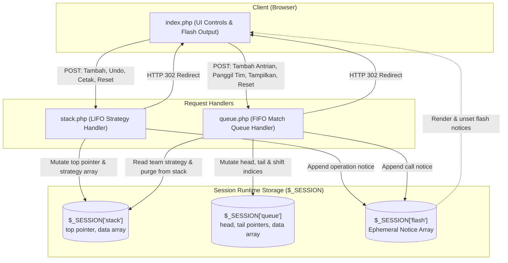

# E-Sport Tournament Management System (Data Structures)

[](https://www.php.net/)
[%20%26%20Queue%20(FIFO)-032B43?style=flat)](https://github.com/pratama1246/ALPRO_Stack-Queue)
[-136F63?style=flat)](https://www.php.net/manual/en/book.session.php)
[](style.css)
[](index.php)
[](LICENSE)

A native PHP web application designed to manage team strategies and tournament match queues through direct implementations of linear Stack (LIFO) and Queue (FIFO) data structures, with zero external dependencies and zero database overhead.

---

## Project Overview

The E-Sport Tournament Management System simulates operational competitive tournament workflows using two fundamental linear data structures:

1. **Stack (LIFO: Last-In, First-Out)**: Records tactical strategies for competing teams sequentially. The newest strategy occupies the top position, enabling instant rollbacks (undo) of recent decisions without altering earlier strategic plans.
2. **Queue (FIFO: First-In, First-Out)**: Schedules match lineups in arrival order. Teams entering the queue first are called to the arena first on a first-come, first-served basis.

Application state resides in memory via native PHP sessions (`$_SESSION`). The system is local-first, requires no external database (MySQL/PostgreSQL), and carries zero telemetry.

---

## Practical Problem-Solution Breakdown

| Tournament Operational Problem | Technical Solution | Implementation Mechanism |
| :--- | :--- | :--- |
| **Rapid Tactic Revision in Draft Rooms**<br>Coaches and analysts often need to revoke the most recent tactical instruction during draft picks without clearing prior plans. | **LIFO Stack** | Invoking `popStrategiTerakhir()` identifies the top index (`top`) of the active team and removes the newest tactic using `array_pop()`. |
| **Unordered Match Staging & Duplicate Entries**<br>Simultaneous registrations risk schedule collisions and accidental double-queuing of the same team. | **FIFO Queue with Duplicate Guard** | The `enqueue()` routine performs a linear traversal from `head` to `tail` to verify that the team is not already queued before appending to index `tail`. |
| **Tactical Handover Upon Match Call**<br>Referees and production desks require an immediate summary of pre-set team strategies when a match is called. | **Cross-Reference Dequeue** | Calling `dequeue()` retrieves the team at index `head`, pulls their recorded tactics from `$_SESSION['stack']`, prints them to the notification log, and cleans up the team entry in the stack. |

---

## Core Engineering Capabilities

### 1. Strategy Stack Module (`stack.php`)
- **Capacity Limit**: Enforces a strict upper bound of 10 entries (`define("MAX", 10)`).
- **Top Pointer**: Monitored via `$stack['top']`, initialized to `-1` to represent an empty stack.
- **Push Operation (`pushStrategi`)**:
  - Scans active teams between index `0` and `top`. If the team exists, appends the new strategy to that team's strategy list.
  - If the team is new and `$stack['top'] < MAX - 1`, increments `top` and allocates a new team node.
  - Rejects incoming pushes with a notification when the stack reaches capacity.
- **Pop Operation (`popStrategiTerakhir`)**:
  - Traverses backwards from index `top` down to `0` to execute `array_pop()` on the latest tactic.
- **Traversal Operation (`cetakStack`)**:
  - Formats all teams and their respective strategies in reverse chronological order (`array_reverse`), placing the newest tactics at the top.
- **Reset Operation (`resetStack`)**:
  - Reinitializes the stack to `top = -1` and `data = []`.

### 2. Match Queue Module (`queue.php`)
- **Queue Bounds**: Enforces a maximum limit of 10 teams (`define("MAX", 10)`).
- **Head & Tail Pointers**: Tracked via `$queue['head']` and `$queue['tail']`, initialized to `-1`.
- **Enqueue Operation (`enqueue`)**:
  - Validates boundary limits via `isQueueFull()`.
  - Scans existing entries to prevent duplicate team registrations.
  - Initializes pointers (`head = tail = 0`) on an empty queue or increments `tail++`.
- **Dequeue Operation (`dequeue`)**:
  - Reads the team from index `head`.
  - Pulls associated strategies from `$_SESSION['stack']` for display in the flash notification log.
  - Shifts remaining elements forward by one index (`$queue['data'][$i] = $queue['data'][$i + 1]`).
  - Removes the old tail element via `unset()`, decrements `tail--`, and resets `head = -1` when the queue becomes empty.
  - Purges the dequeued team from stack memory using `array_splice()` and decrements `$stack['top']`.
- **Display Operation (`tampilkanQueue`)**:
  - Enumerates active queue positions sequentially from `head` through `tail`.
- **Reset Operation (`resetQueue`)**:
  - Restores queue pointers to `head = -1`, `tail = -1`, and empties the data container.

### 3. Flash Notification Subsystem
- Stores feedback messages in `$_SESSION['flash'][]`.
- Displays pending status notices inside `index.php` and immediately cleans up memory via `unset($_SESSION['flash'])` to ensure ephemeral presentation.

---

## System Architecture

The following diagram details client form submissions, HTTP POST routing, session state mutations, and redirect rendering:



---

## Directory Structure

```text
Turnamen-ESport-StrukturData/
├── index.php    # Primary entry point: form inputs, dynamic dropdowns, and notification log
├── queue.php    # FIFO queue logic: enqueue, dequeue, array element shift, and reset
├── stack.php    # LIFO stack logic: strategy push, undo pop, traversal print, and reset
├── style.css    # Responsive stylesheet: two-column flex layout and mobile breakpoint
├── LICENSE      # MIT License terms
└── README.md    # System documentation and operational runbook
```

### Component Responsibilities

- **`index.php`**: Primary view and presentation layer. Dynamically renders `<select>` options from registered stack teams in `$_SESSION['stack']['data']`, routes form submissions, and displays flash notices.
- **`stack.php`**: Controller for stack-based tactical operations (`Tambah`, `Undo`, `Cetak`, and `Reset Strategi`).
- **`queue.php`**: Controller for queue-based match operations (`Tambah Antrian`, `Panggil Tim`, `Tampilkan Antrian`, and `Reset Antrian`). Coordinates with stack data during match dispatch.
- **`style.css`**: Styling layer implementing a two-column responsive desktop layout with an adaptive `1080px` breakpoint for mobile displays.

---

## Installation & Operational Runbook

### System Prerequisites
- PHP 7.4, 8.0, 8.1, 8.2, or 8.3 installed on host.
- Modern web browser (Chrome, Firefox, Safari, Edge).

### Option 1: PHP Built-in Server (Fastest Local Setup)

1. Clone the repository:
   ```bash
   git clone https://github.com/pratama1246/ALPRO_Stack-Queue.git
   cd ALPRO_Stack-Queue
   ```

2. Start the built-in development server:
   ```bash
   php -S localhost:8000
   ```

3. Open your browser and navigate to:
   ```text
   http://localhost:8000
   ```

### Option 2: Apache via XAMPP, Laragon, or WampServer

1. Place the project directory inside the server web root:
   - XAMPP: `C:\xampp\htdocs\ALPRO_Stack-Queue`
   - Laragon: `C:\laragon\www\ALPRO_Stack-Queue`
2. Start the **Apache** service.
3. Access the application in your browser:
   ```text
   http://localhost/ALPRO_Stack-Queue/
   ```

### Option 3: Docker Container

Run an isolated PHP 8.2 Apache container with a single command:
```bash
docker run -d --name esport-tournament -p 8000:80 -v "${PWD}:/var/www/html" php:8.2-apache
```
Access the application at `http://localhost:8000`.

---

## Interface Actions & Logic Reference

| Form Section | Action Button | Target Script | Data Routine | State Effect |
| :--- | :--- | :--- | :--- | :--- |
| **Input Strategi Tim** | `Tambah` | `stack.php` | `pushStrategi()` | Team and strategy pushed to stack. Queue dropdown updates. |
| **Input Strategi Tim** | `Undo` | `stack.php` | `popStrategiTerakhir()` | Topmost strategy of the target team popped from stack. |
| **Input Strategi Tim** | `Cetak` | `stack.php` | `cetakStack()` | Traverses stack from top down and prints all active tactics. |
| **Input Strategi Tim** | `Reset Strategi` | `stack.php` | `resetStack()` | Clears all stack data and resets top pointer to `-1`. |
| **Antrian Pertandingan**| `Tambah Antrian` | `queue.php` | `enqueue()` | Inserts team at index `tail` (blocked if duplicate exists). |
| **Antrian Pertandingan**| `Panggil Tim` | `queue.php` | `dequeue()` | Dispatches team at index `head`, displays strategies, shifts array forward, and removes team from stack. |
| **Antrian Pertandingan**| `Tampilkan Antrian`| `queue.php` | `tampilkanQueue()` | Prints active queue positions from index 1 through N. |
| **Antrian Pertandingan**| `Reset Antrian` | `queue.php` | `resetQueue()` | Clears queue array and resets head and tail pointers to `-1`. |

---

## License

This project is distributed under the terms of the [MIT License](LICENSE).
