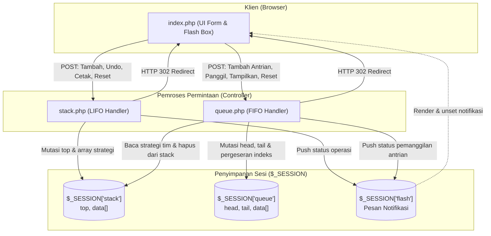

# Sistem Manajemen Turnamen E-Sport Berbasis Struktur Data

[](https://www.php.net/)
[%20%26%20Queue%20(FIFO)-032B43?style=flat)](https://github.com/pratama1246/ALPRO_Stack-Queue)
[-136F63?style=flat)](https://www.php.net/manual/en/book.session.php)
[](style.css)
[](index.php)
[](LICENSE)

Aplikasi web native berbasis PHP untuk mengelola strategi tim dan antrian pertandingan turnamen e-sport menggunakan implementasi langsung struktur data linear Stack (LIFO) dan Queue (FIFO) tanpa framework eksternal maupun database engine.

---

## Ringkasan Proyek

Sistem Manajemen Turnamen E-Sport dirancang untuk memenuhi kebutuhan simulasi alur operasional kompetisi e-sport pada tingkat teknis dasar. Aplikasi ini mengimplementasikan dua pilar utama struktur data komputer:

1. **Stack (LIFO: Last-In, First-Out)**: Digunakan untuk mencatat strategi taktis tim secara berurutan. Strategi terbaru yang dimasukkan menjadi elemen paling atas, sehingga fitur koreksi atau pembatalan (*undo*) dapat mencabut keputusan taktis terakhir secara instan.
2. **Queue (FIFO: First-In, First-Out)**: Digunakan untuk mengelola antrian giliran bertanding antar tim. Tim yang pertama mendaftar antrian akan dipanggil pertama kali ke arena pertandingan (*first-come, first-served*).

Seluruh status aplikasi disimpan langsung di dalam memori runtime melalui `$_SESSION` PHP native. Sistem bersifat local-first, berjalan tanpa ketergantungan database MySQL/PostgreSQL, serta bebas dari telemetri eksternal.

---

## Masalah dan Solusi Praktis

| Masalah Operasional Lapangan | Solusi Teknis Struktur Data | Mekanisme Implementasi |
| :--- | :--- | :--- |
| **Koreksi Taktik Cepat di Ruang Tunggu**<br>Pelatih atau analis tim sering kali perlu merevisi perintah taktik terakhir saat draft pick berlangsung tanpa merusak riwayat taktik sebelumnya. | **LIFO Stack** | Pemanggilan `popStrategiTerakhir()` mencabut elemen indeks puncak (*top*) dari tim bersangkutan menggunakan `array_pop()`. |
| **Penumpukan Antrian Tidak Teratur**<br>Perebutan jadwal tanding dan risiko pemanggilan tim ganda saat turnamen berlangsung serentak. | **FIFO Queue dengan Proteksi Duplikasi** | Fungsi `enqueue()` melakukan validasi linear traversal untuk memastikan nama tim belum terdaftar di antrian aktif sebelum menempatkannya di posisi `tail`. |
| **Sinkronisasi Data Taktik saat Tim Dipanggil**<br>Petugas turnamen membutuhkan ringkasan taktik yang sudah disiapkan tim saat giliran tanding tiba. | **Cross-Reference Dequeue** | Saat `dequeue()` dijalankan pada posisi `head`, sistem otomatis membaca daftar strategi tim dari `$_SESSION['stack']`, menampilkan ringkasan ke notifikasi, lalu membersihkan entri tim dari stack. |

---

## Fitur dan Spesifikasi Teknis

### 1. Modul Manajemen Strategi (`stack.php`)
- **Kapasitas Maksimum**: Dibatasi hingga 10 tim (`define("MAX", 10)`).
- **Indeks Top**: Posisi tumpukan dipantau via `$stack['top']` dengan nilai awal `-1` (kondisi kosong).
- **Operasi Push (`pushStrategi`)**:
  - Memeriksa apakah nama tim sudah ada pada rentang `0` sampai `top`. Jika ada, strategi baru di-append ke array strategi tim terkait.
  - Jika tim belum ada dan `$stack['top'] < MAX - 1`, indeks `top` dinaikkan dan entri tim baru dibuat.
  - Menolak penambahan bila tumpukan telah mencapai batas kapasitas maksimum.
- **Operasi Pop (`popStrategiTerakhir`)**:
  - Melakukan pencarian dari indeks `top` menurun ke `0` untuk mengeksekusi `array_pop` pada strategi paling akhir.
- **Operasi Traversal / Cetak (`cetakStack`)**:
  - Menampilkan daftar tim beserta strateginya secara terbalik (`array_reverse`), memastikan strategi terkini berada di urutan teratas.
- **Operasi Reset (`resetStack`)**:
  - Mengembalikan struktur stack ke status inisial `top = -1` dan `data = []`.

### 2. Modul Antrian Pertandingan (`queue.php`)
- **Kapasitas Antrian**: Dibatasi hingga 10 antrian (`define("MAX", 10)`).
- **Indeks Head & Tail**: Dipantau melalui `$queue['head']` dan `$queue['tail']` dengan nilai inisial `-1`.
- **Operasi Enqueue (`enqueue`)**:
  - Memvalidasi status penuh via `isQueueFull()`.
  - Melakukan pengecekan duplikasi agar tim yang sama tidak masuk dua kali.
  - Menginisialisasi `head = tail = 0` jika antrian kosong, atau menaikkan pointer `tail++`.
- **Operasi Dequeue (`dequeue`)**:
  - Mengambil data tim pada indeks `head`.
  - Mengambil daftar strategi tim dari stack untuk ditampilkan ke flash session.
  - Menggeser seluruh elemen berikutnya ke depan satu indeks (`$queue['data'][$i] = $queue['data'][$i + 1]`).
  - Menghapus posisi lama `tail` via `unset()`, menurunkan pointer `tail--`, dan menyetel `head = -1` jika antrian kosong.
  - Menghapus data tim dari stack menggunakan `array_splice()` serta menurunkan pointer `$stack['top']`.
- **Operasi Display (`tampilkanQueue`)**:
  - Menampilkan urutan antrian aktif dari posisi `head` hingga `tail`.
- **Operasi Reset (`resetQueue`)**:
  - Mengembalikan nilai pointer `head = -1`, `tail = -1`, dan mengosongkan data.

### 3. Flash Notification Engine
- Menyimpan status feedback operasi (`$_SESSION['flash'][]`).
- Ditampilkan pada kontainer notifikasi di `index.php` dan langsung dihapus melalui `unset($_SESSION['flash'])` agar tidak terjadi perulangan pesan (*ephemeral state*).

---

## Arsitektur Sistem

Alur interaksi pengguna, routing aksi form HTTP POST, mutasi session memori, dan pergeseran elemen digambarkan pada diagram berikut:



---

## Struktur Direktori

```text
Turnamen-ESport-StrukturData/
├── index.php    # Halaman utama: formulir input, dropdown dinamis, dan box notifikasi
├── queue.php    # Logika FIFO queue: enqueue, dequeue, geser elemen, dan reset
├── stack.php    # Logika LIFO stack: push strategi, undo pop, cetak, dan reset
├── style.css    # Desain tampilan responsif (layout dua kolom dan breakpoint mobile)
└── README.md    # Dokumentasi arsitektur dan panduan operasional proyek
```

### Panduan Tanggung Jawab Berkas

- **`index.php`**: Berkas presentasi utama. Membaca `$_SESSION['stack']['data']` untuk mengisi pilihan `<select>` secara dinamis, mengarahkan form ke pengendali terkait, dan menampilkan notifikasi flash.
- **`stack.php`**: Penanggung jawab manipulasi array tumpukan strategi. Memproses aksi `Tambah`, `Undo`, `Cetak`, dan `Reset Strategi`.
- **`queue.php`**: Penanggung jawab antrian pertandingan. Memproses aksi `Tambah Antrian`, `Panggil Tim`, `Tampilkan Antrian`, dan `Reset Antrian`. Berinteraksi langsung dengan stack untuk integrasi data strategi.
- **`style.css`**: Pengatur tata letak antarmuka. Menggunakan Flexbox dua kolom dengan palet warna kontras (`#032B43`, `#FFBA08`, `#136F63`, `#D00000`, `#F5F5F5`), serta breakpoint responsif `1080px` untuk perangkat mobile.

---

## Panduan Instalasi dan Pengoperasian

### Kebutuhan Sistem
- Runtimes: PHP versi 7.4, 8.0, 8.1, 8.2, atau 8.3.
- Web Browser modern (Chrome, Firefox, Safari, Edge).

### Cara 1: Menggunakan PHP Built-in Server (Metode Paling Cepat)

1. Clone repositori ke komputer lokal:
   ```bash
   git clone https://github.com/pratama1246/ALPRO_Stack-Queue.git
   cd ALPRO_Stack-Queue
   ```

2. Jalankan server bawaan PHP:
   ```bash
   php -S localhost:8000
   ```

3. Buka peramban web pada tautan:
   ```text
   http://localhost:8000
   ```

### Cara 2: Menggunakan XAMPP / Laragon / WampServer

1. Salin atau pindahkan folder proyek ke direktori web server:
   - XAMPP: `C:\xampp\htdocs\ALPRO_Stack-Queue`
   - Laragon: `C:\laragon\www\ALPRO_Stack-Queue`
2. Pastikan service **Apache** sudah berjalan.
3. Akses aplikasi melalui URL:
   ```text
   http://localhost/ALPRO_Stack-Queue/
   ```

### Cara 3: Menggunakan Docker

Jalankan server Apache berbasis PHP 8.2 secara langsung tanpa instalasi lokal:
```bash
docker run -d --name esport-turnamen -p 8000:80 -v "${PWD}:/var/www/html" php:8.2-apache
```
Akses melalui `http://localhost:8000`.

---

## Matriks Operasi dan Aksi Antarmuka

| Formulir | Tombol Aksi | Target Berkas | Aksi Logika Data | Hasil Keluaran |
| :--- | :--- | :--- | :--- | :--- |
| **Input Strategi Tim** | `Tambah` | `stack.php` | `pushStrategi()` | Entri tim/strategi masuk ke stack. Dropdown antrian diperbarui. |
| **Input Strategi Tim** | `Undo` | `stack.php` | `popStrategiTerakhir()` | Strategi teratas dari tim terakhir dihapus dari stack. |
| **Input Strategi Tim** | `Cetak` | `stack.php` | `cetakStack()` | Seluruh tim dan daftar strateginya ditampilkan dari posisi top. |
| **Input Strategi Tim** | `Reset Strategi` | `stack.php` | `resetStack()` | Seluruh memori stack dihapus (`top = -1`). |
| **Antrian Pertandingan**| `Tambah Antrian` | `queue.php` | `enqueue()` | Tim dimasukkan ke posisi `tail` (ditolak jika sudah ada di antrian). |
| **Antrian Pertandingan**| `Panggil Tim` | `queue.php` | `dequeue()` | Tim posisi `head` dipanggil beserta strateginya, elemen antrian digeser maju, entri tim dikeluarkan dari stack. |
| **Antrian Pertandingan**| `Tampilkan Antrian`| `queue.php` | `tampilkanQueue()` | Urutan antrian aktif dari posisi 1 hingga N ditampilkan. |
| **Antrian Pertandingan**| `Reset Antrian` | `queue.php` | `resetQueue()` | Seluruh antrian dihapus (`head = -1`, `tail = -1`). |

---

## Metadata Akademik Proyek

Proyek ini disusun sebagai bagian dari pemenuhan Ujian Tengah Semester (UTS) mata kuliah Pemrograman Struktur Data:

- **Mata Kuliah**: Pemrograman Struktur Data (Materi: Stack & Queue)
- **Dosen Pengampu**: Dwi Novia Prasetyanti, S.Kom., M.Cs.
- **Institusi**: Politeknik Negeri Cilacap
- **Program Studi / Kelas**: D3 Teknik Informatika / 1D
- **Tahun Akademik**: 2024/2025

### Tim Penyusun
1. Aliyya Fadhilah (NIM: 240102097)
2. Amelia Nur Hamda Rina (NIM: 240102098)
3. Nuke Zahra Alifia (NIM: 240302113)
4. Panji Parisya Akmal Hoetomo (NIM: 240202114)
5. Pratama Putra Purwanto (NIM: 240202115)

---

## Lisensi

Proyek ini didistribusikan di bawah lisensi terbuka [MIT License](LICENSE) untuk keperluan edukasi dan pengembangan akademis.
